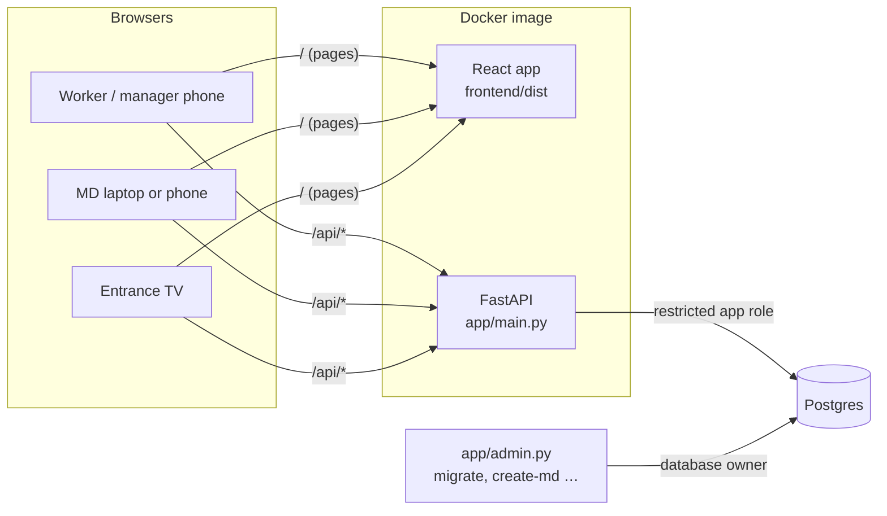
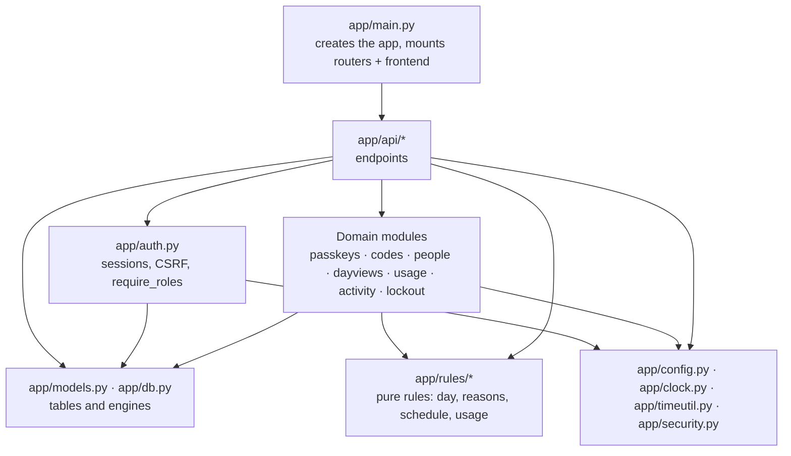
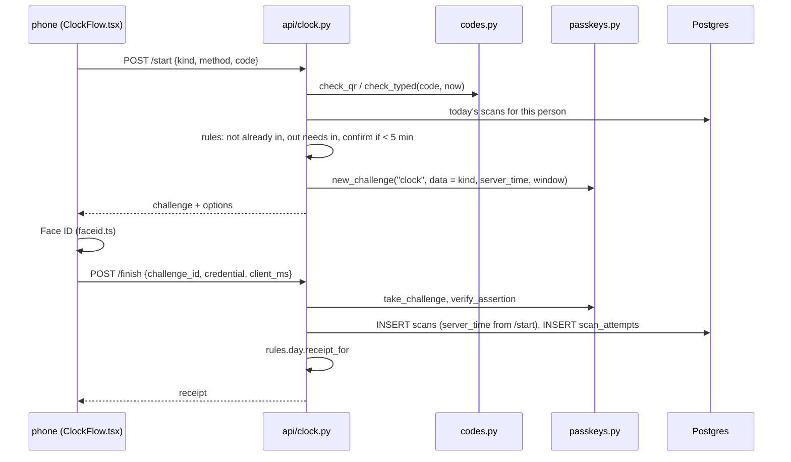

# How the code is put together

OfficeLog is one program on one web address. A FastAPI backend answers `/api/*` and also serves
the built React app for every other path, so the phones, the MD's pages and the TV all talk to the
same origin. One Docker image holds both; Postgres holds the data.

## Repository layout

| Path | What |
|---|---|
| `app/` | The backend (Python 3.12, FastAPI, SQLAlchemy). |
| `app/api/` | HTTP endpoints, one module per area. Thin: check who is calling, call the domain code, shape the JSON. |
| `app/rules/` | The attendance rules as pure functions: no database, no framework, no clock. |
| `migrations/` | Alembic database migrations. |
| `frontend/` | The React + TypeScript + Vite app for phones, the MD and the TV. |
| `tests/` | pytest tests (they need a Postgres server) and the shared code test vectors. |
| `scripts/start.sh` | Container start: run `migrate`, then start uvicorn. |
| `Dockerfile`, `railway.json`, `docker-compose.yml` | Build, deploy and local-run configuration. |

## Backend layers

A request flows down these layers and never up:

Three rules keep this tidy:

- **The rules are pure.** `app/rules/` never imports the database or FastAPI (a test checks this).
  Modules like `dayviews.py` and `usage.py` load facts from the database and hand them over.
- **Time comes from a `Clock`.** Business code never calls `datetime.now()`; it takes a `Clock`
  (`app/clock.py`). Tests pass a `FixedClock` to act out any moment of any day.
- **Roles are checked on the server.** Every endpoint declares its roles with
  `require_roles(...)`. A test walks `ROUTERS` in `app/main.py` and checks every endpoint against a
  permission table. Hiding a button in the UI is never the check.

## Backend modules

### Foundation

| Module | Job | Used by |
|---|---|---|
| `app/main.py` | Builds the FastAPI app: includes every router in `ROUTERS`, adds `/api/health` and security headers, serves `frontend/dist` with `index.html` for client-side routes. | uvicorn |
| `app/config.py` | All settings, read from environment variables (and `.env`). Parses the schedule, holidays and timezone at start-up so a bad value fails fast. | everything |
| `app/db.py` | Two engines: `app_engine()` (the restricted app role, for requests) and `owner_engine()` (the owner, for migrations). `get_db()` gives each request a session. | endpoints, admin |
| `app/dbrole.py` | Creates the restricted database role and grants it exactly the privileges in `TABLE_PRIVILEGES`. | `admin migrate` |
| `app/models.py` | The database tables as SQLAlchemy models, with their constraints. | everything that touches data |
| `app/clock.py` | `Clock`, `SystemClock`, `FixedClock`. | endpoints, tests |
| `app/timeutil.py` | Company-local date and time helpers (`work_date`, `local_hhmm`, greetings, first names). | endpoints, domain |
| `app/security.py` | Argon2 password hashing, random tokens, SHA-256 token hashes, constant-time compare. | auth, invites, kiosk, admin |

### Domain

| Module | Job | Used by |
|---|---|---|
| `app/auth.py` | Starts and ends sessions (httpOnly cookie, only its hash stored), checks the CSRF header on changes, and provides `current_user` and `require_roles`. | every endpoint |
| `app/passkeys.py` | WebAuthn: one-time challenges, registration and assertion options, verification. | `api/auth`, `api/invites`, `api/clock` |
| `app/codes.py` | The rotating code algorithm (HMAC per day and purpose, 6 digits by RFC 4226 truncation), and checking a scanned QR or typed code. Pure. | `api/kiosk`, `api/clock` |
| `app/lockout.py` | 5 failed sign-ins within 15 minutes lock that email or phone for 15 minutes. | `api/auth` |
| `app/people.py` | Add a worker or the manager, deactivate, reset a phone, make and revoke TV setup codes. Shared by the screens and the admin command line so both behave the same. | `api/people`, `api/kiosks`, `api/md`, `api/kiosk` |
| `app/dayviews.py` | Loads scans, reasons and decisions for a set of people and dates, and calls `rules.day.day_view` for each. | `api/me`, `api/team`, `api/reasons`, `usage` |
| `app/usage.py` | Gathers the facts for the usage numbers and calls `rules.usage`. | `api/md`, `admin usage` |
| `app/activity.py` | `log(...)`: adds one row to the activity log. | every module that changes something |
| `app/admin.py` | The command line: `migrate`, `create-md`, `create-manager`, `create-worker`, `reset-phone`, `create-tv-link`, `usage` … | operators, `scripts/start.sh` |

### Rules (pure)

| Module | Job |
|---|---|
| `app/rules/schedule.py` | Parses `SCHEDULE_JSON` (start, grace, close, missing-clock-out cutoff per weekday) and `HOLIDAYS`. Holds the default schedule. |
| `app/rules/day.py` | One person's day: minutes late, minutes left early, hours worked, absent, no clock-out, excused, the receipt, and the one status word for lists. |
| `app/rules/reasons.py` | Whether a reason may be sent for a day (it must match what happened, within 7 days) and who may decide it. |
| `app/rules/usage.py` | The usage calculations: both scans, first-try success, median tap-to-receipt, failure labels, totals. |

### Endpoints (`app/api/`)

| Module | Prefix | Who | What |
|---|---|---|---|
| `auth.py` | `/api/auth` | anyone | MD password sign-in, phone passkey sign-in, sign out, `me` |
| `invites.py` | `/api/invites` | anyone with the link | Read an invite, register the phone's passkey, start a session |
| `kiosk.py` | `/api/kiosk` | the TV | Pair with a setup code; fetch the current codes and recent scans |
| `clock.py` | `/api/clock` | worker, manager | `start` (check the code, return a Face ID challenge) and `finish` (verify, save the scan) |
| `me.py` | `/api/me` | worker, manager | Today and monthly history |
| `team.py` | `/api/team` | manager, MD | Everyone's day today |
| `reasons.py` | `/api` | worker, manager, MD | Send and edit reasons, approvals list, decide, override (MD) |
| `paper.py` | `/api/paper` | manager, MD | A day's times, and adding times from the paper sheet |
| `people.py` | `/api/people` | manager | List, add, reset phone, deactivate |
| `kiosks.py` | `/api/kiosks` | manager | TV status, get a setup code, remove a TV |
| `md.py` | `/api` | MD | Today board for any day, people, history per person, usage, add the manager |
| `activity_log.py` | `/api/activity` | MD | The activity log, filtered and paged |
| `privacy.py` | `/api/privacy` | anyone | Company name and privacy contact for the notice |

`app/api/md.py` reuses `team.team_day` and `me.month_history`, so the MD sees exactly what the
manager and each worker see.

## Clocking in, through the modules

Every attempt, successful or not, adds a row to `scan_attempts`, which feeds the usage numbers.

## Frontend

`frontend/src/` is one React app. `App.tsx` picks pages by path and role; heavy pages are loaded
only when needed (the TV never downloads the camera scanner, phones never download the TV board).

| Path | What |
|---|---|
| `main.tsx`, `App.tsx` | Start-up and routing; guards for "clocks in", "manager only", "MD only". |
| `session.tsx` | Loads `/api/auth/me` once and shares the signed-in person and CSRF token. |
| `api.ts` | Every API call, typed. Sends cookies and the `X-CSRF-Token` header. |
| `faceid.ts` | Passkey registration and sign-in via `@simplewebauthn/browser`. |
| `codes.ts` | A line-by-line browser copy of `app/codes.py`. `tests/fixtures/code_vectors.json` and `codes.test.ts` keep the two identical. |
| `format.ts` | Small display helpers. |
| `pages/phone/` | Workers and the manager: `Welcome` (invite), `SignIn`, `Today`, `ClockFlow` (scan → Face ID → receipt), `History`, `Reasons`, `AddReason`, `PrivacyNotice`. |
| `pages/manager/` | The manager's extra tabs: `Team`, `Approvals`, `People`, `InviteCard`, `TvSetup`, `PaperTime`. |
| `pages/md/` | The MD: `SignIn`, `Shell` (web layout on a laptop, app layout with a tab bar on a phone), `Home` (Today board), `People`, `Person`, `ManagerCard`, `Approvals`, `Activity`, `Usage`. |
| `pages/tv/` | `Tv.tsx` (the welcome board and pairing screen) and its own `tv.css`. |
| `ui/` | Shared pieces: buttons, sheets, alerts, grouped lists, tab bar, status pills, day bar, QR code, icons. |
| `styles/` | `tokens.css` (all colours, light and dark) and `base.css`. Pages use tokens, never raw colours. |

The Vite build (`vite.config.ts`) also makes a legacy bundle for old TV browsers.

## Tests

`tests/` covers the rules (late boundaries per weekday, left early, absent, missing clock-out,
reasons, usage), the code algorithm against shared vectors, every endpoint's role permissions,
passkeys with a software authenticator (`tests/softauthn.py`), the lockout, the database role's
privileges, and that `app/rules` stays pure. The frontend has Vitest tests for `codes.ts`.
