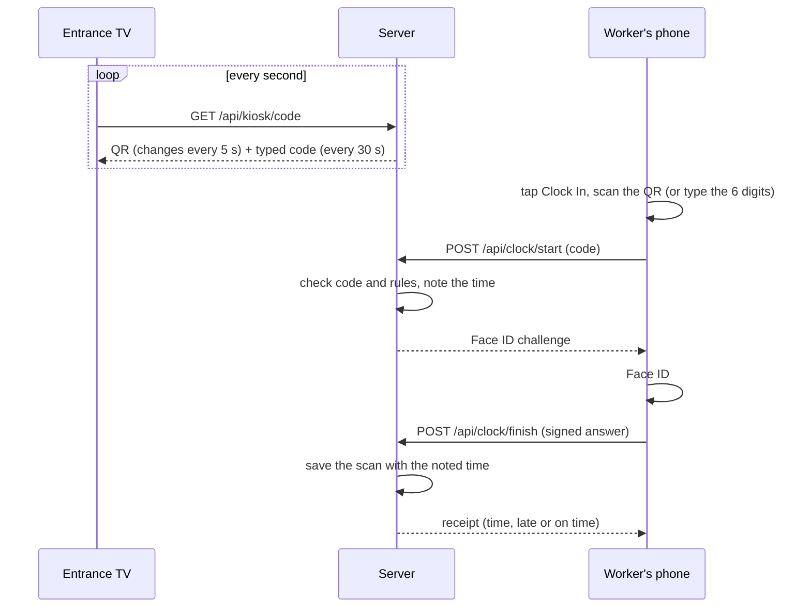

# What OfficeLog does

OfficeLog records when each worker arrives and leaves. A TV at the entrance shows a code that
changes every few seconds. Workers scan it with their phone, confirm with Face ID, and the time is
saved. The manager and the managing director (MD) see everyone's day, deal with reasons for
lateness or absence, and the MD can see how much the app is actually used.

## Who uses it

| Who | Device | What they do |
|---|---|---|
| **Worker** | their own phone | Clocks in and out, sees their history, sends a reason when late, absent, leaving early or after forgetting to clock out. |
| **Manager** (exactly one) | their own phone | Everything a worker does, plus: sees the team's day, decides workers' reasons, adds and removes people, resets a lost phone, sets up the entrance TV, adds time from the paper sheet. |
| **MD** (exactly one) | laptop or phone | Signs in with email and password. Sees any day, each person's history, decides the manager's reasons, can override any decision, reads the activity log, sees the usage numbers, adds the manager. The MD does not clock in. |
| **Entrance TV** | a smart TV's web browser | Shows the rotating code, the time and the last few people who scanned. It never signs in as a person. |

## A working day

1. **Arriving.** The worker taps **Clock In** and points the camera at the TV. If the camera
   can't read it, they type the 6-digit code under the QR. Face ID confirms it is really them, on
   their registered phone. The phone shows a receipt: the time, and whether they were on time or
   how many minutes late.
2. **Leaving.** The same, with **Clock Out**. Clocking out before the day's close time is marked
   "Left early". Clocking out within 5 minutes of clocking in asks "Clock out anyway?".
3. **Reasons.** A worker who was late, absent, left early or forgot to clock out can send a reason,
   up to 7 days later. The manager approves or rejects workers' reasons; the MD decides the
   manager's. Nobody decides their own. An approved reason turns "Late" into "Excused". For a
   missed clock-out, the worker says what time they left; once approved, that time counts.
4. **Paper sheet.** If the TV is down, a worker has no smartphone, or a phone is dead or forgotten,
   the manager (or the MD) adds the time from the office's paper sheet and picks which of those
   three applies. It is shown everywhere as "added from paper by <name>".
5. **After hours.** A working day with no clock-in becomes "Absent" once the close time passes. A
   clock-in with no clock-out becomes "No clock-out" an hour after close.
6. **Oversight.** The MD can change any decision with **Override**. The old decision stays on
   record and the newest one counts. Every important action is written to the activity log.

## Getting a phone set up

The manager adds a person by name and gets a one-time invite link (valid 48 hours), shown as a QR
code, a link to copy, or the phone's share sheet. The worker opens it **on their own phone**, adds
the app to the home screen, and sets up Face ID. That phone's passkey is now their only way in. If
the phone is lost, the manager taps **Reset Phone**: the old phone stops working at once and a new
invite is made. The MD adds the manager the same way, from MD → People.

## Setting up the TV

The manager taps **Get a Setup Code** (People → Entrance TV) and gets a 10-character code such as
`HGDNM-46K4P`, valid once for 24 hours. On the TV, they open `/tv` in the browser and type it. From
then on the TV keeps its own long-lived cookie. It shows "Connection lost" and hides the code when
it can't reach the server, and reloads itself when stuck, when a new version is deployed, and once a
day around 04:00.

## The usage numbers

OfficeLog started as a trial, and the main question was: *do people actually use it?* The MD's
Usage page (and `python -m app.admin usage`) answers that per working day and in total:

- **Both scans:** the share of active people who clocked in *and* out with the app. Paper times
  and approved claimed clock-outs don't count, because they aren't app use.
- **First try:** how often a scan works on the first attempt.
- **Tap to receipt:** the median time the phone measured from tapping the button to the receipt.
- Failed attempts by cause (code too old, already clocked in, Face ID didn't work …), missing
  clock-outs, paper times, and reasons sent.

## Privacy

Built for the Nigeria Data Protection Act 2023. OfficeLog records only a person's name, their clock
times, their phone's passkey and the internet address of each scan. It never records location,
photos or a face (Face ID happens on the phone; the server only sees a signature). The data is seen
by the person, the manager and the MD. The notice is at `/privacy` and is linked under the
**Continue** button on the invite screen; tapping Continue records that the person saw it. The
contact person comes from the `PRIVACY_CONTACT` setting.

## Design choices, and why

- **Face ID instead of a PIN.** Phones sign in with a WebAuthn passkey that lives in the phone's
  secure hardware and needs Face ID, a fingerprint or the phone passcode each time. It can't be
  copied to another phone, so a worker can't hand their login to a friend.
- **Codes are made by the server.** The TV only displays them and holds no secret. The QR changes
  every 5 seconds so a photo of it is useless moments later; the typed code changes every 30 seconds
  so it can actually be typed. The algorithm is a single pure module (`app/codes.py`, mirrored in
  `frontend/src/codes.ts`) so a later version can let the TV make codes offline without changing the
  QR format.
- **The time is taken when the code is checked,** not when Face ID finishes, so a slow Face ID
  prompt can't make someone late or let an old code through.
- **Recorded times are never edited.** Paper times and approved claims are added as new facts, never
  changes. The database itself enforces this: the app connects as a restricted user that can only
  read and add rows to scans, decisions and the activity log, and a trigger blocks changes to the
  activity log for everyone.
- **Old TVs work.** The build adds a "legacy" bundle with polyfills so older Samsung and LG TV
  browsers can run the board.
- **Schedule without a rebuild.** Working hours per weekday and holidays are settings; changing
  them needs only a restart.

See [architecture.md](architecture.md) for how the code is put together,
[data-and-rules.md](data-and-rules.md) for the tables and rules, and
[operations.md](operations.md) to run and deploy it.
